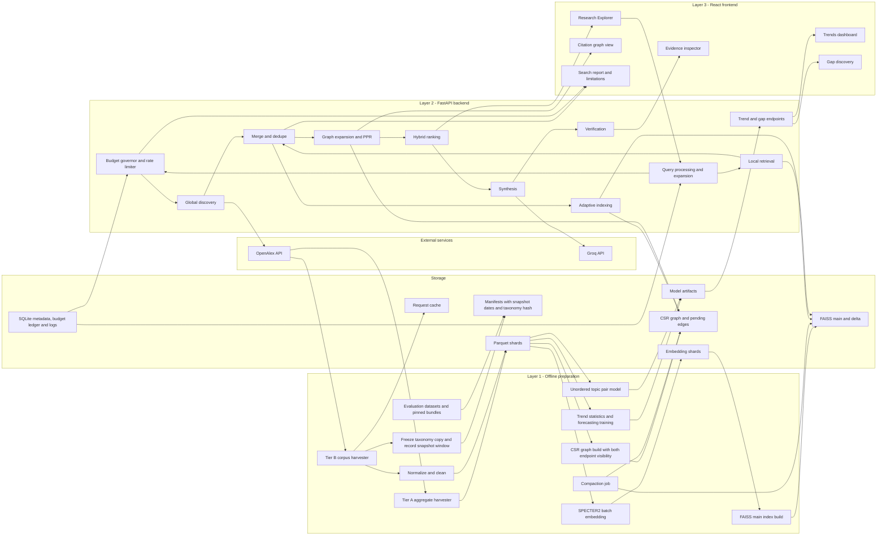
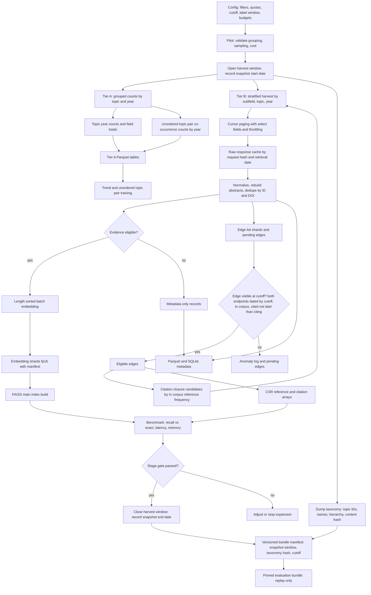
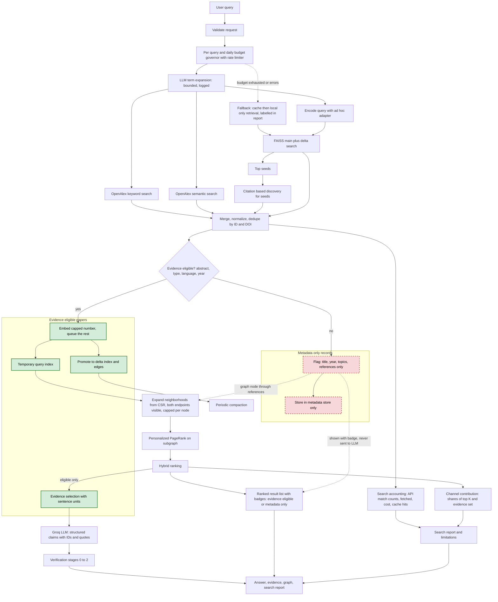

<<<<<<< HEAD
# ARCHITECTURE.md: Architecture B (approved v1.1)

Single source of truth for design. Definitions, thresholds and metrics live in `PROTOCOL.md`; if the two disagree, PROTOCOL.md wins and the conflict goes to `OPEN_QUESTIONS.md`.

## 1. Principles
1. Global discovery is never limited by local corpus size. Local corpus sizes (10k, 100k, 500k, ...) are infrastructure benchmarks.
2. The OpenAlex work ID is the canonical key everywhere.
3. Three time axes (publication date, snapshot date, evaluation cutoff) are tracked separately; see PROTOCOL.md section 3.
4. Incremental by construction: append, cache, compact. Never rebuild everything.
5. Reproducible: versioned manifests, hash-keyed request cache, replay-only evaluation builds.
6. Honest reporting: every answer shows a search report and limitations.
7. Simple before sophisticated. GraphSAGE, fused-embedding GNN, temporal GNN and cross-encoder reranking are optional experiments, not components.

## 2. Locked technology baseline
OpenAlex API; SPECTER2 (pretrained only); FAISS; CSR sparse citation graph; NetworkX for small query subgraphs; Groq API (model chosen by benchmark); FastAPI + Pydantic; React; statistical trend methods; statistical baselines then gradient boosting; unordered topic-pair prediction plus evidence validation; staged verification. Storage: Parquet, DuckDB, SQLite (PostgreSQL deferred).

## 3. Layers
- **Layer 1, offline:** Tier A and Tier B harvest, cleaning, manifests, embedding shards, FAISS main build, CSR build, trend statistics, forecasting and topic-pair training, evaluation datasets, compaction.
- **Layer 2, online (FastAPI), per query:** validation, budget governor, term expansion, OpenAlex discovery, query encoding, main+delta vector search, merge and dedupe, capped embedding of new eligible papers, graph expansion and PageRank, hybrid ranking, adaptive indexing, synthesis, verification, search report; trend and gap endpoints serve precomputed results plus on-demand evidence building.
- **Layer 3, React:** Research Explorer, literature cards, citation graph view, trends dashboard, gap discovery, evidence inspector, search report and limitations panel.

Planned endpoints: `POST /search`, `POST /synthesize`, `GET /trends`, `GET /trends/{topic_id}`, `GET /gaps`, `GET /papers/{id}`, `GET /graph/{id}`, `GET /search-report/{search_id}`. API keys stay in the backend only.

## 4. Key mechanisms (summary; details in PROTOCOL.md)
- **Evidence-eligible vs metadata-only:** a paper is evidence-eligible only if it has an abstract of usable length, an accepted type and language, and a year in range. Metadata-only records may appear in result lists with a badge and may be graph nodes, but are never embedded for evidence, never sent to the LLM, never cited as evidence.
- **Index lifecycle:** retrieve, cache, normalize, dedupe, (if eligible) embed, temporary in-memory index, promote to persistent delta index and delta edge shards, periodic compaction into main index and CSR with an atomic manifest switch.
- **Graph:** edge A?B means A cites B. Reference CSR and citation CSR both stored. Edge visible at a cutoff only if both endpoints are visible. Pending-edges table for targets not yet in corpus.
- **Hybrid score:** see PROTOCOL.md section 6.
- **Verification stages:** 0 ID and normalized-quote check; 1 best sentence plus NLI; 2 LLM judge for flagged cases; 3 human sample. All evidence is tagged "abstract only".
- **Gaps:** unordered topic pairs, positive / reliable negative / ambiguous labels, evidence pipeline with counterevidence and a broader OpenAlex check, confidence levels Rejected / Speculative / Candidate / Expert-reviewed.

## 5. Storage layout
This is the **only** canonical layout. Do not create alternative folders (for example `config/`, `source/`, `notebooks/` as a code location, `utils/`, `data_raw/`). A new top-level folder requires a `CHANGELOG.md` entry approved by a reviewer, and `tests/test_repo_layout.py` enforces the list below.
```
project/
  AGENTS.md  .gitignore  .python-version  .env.example  Makefile  CHANGELOG.md  OPEN_QUESTIONS.md
  requirements.txt          # exact pins for direct dependencies
  requirements-lock.txt     # full resolved environment, generated (see AGENTS.md section 4)
  .agents/rules/            # short rule files for Antigravity (see AGENTS.md)
  configs/                  # pipeline, thresholds, budgets (no secrets)
  docs/                     # ARCHITECTURE.md, PROTOCOL.md, results_notes/, annotation/
  src/{data,kg,embed,topics,forecast,rag,verify,gaps,app,common}/
  tests/
  scripts/
  data/                     # git-ignored
    manifests/              # harvest runs, corpus versions, build bundles (snapshot window, taxonomy hash, cutoff)
    cache/openalex/         # compressed raw responses keyed by request hash and retrieval date
    tier_a/                 # topic-year counts, field totals, pair co-assignment counts
    tier_b/works/           # metadata + abstract shards with origin tags
    tier_b/edges/           # citation edge shards; pending_edges/
    embeddings/             # per-shard fp16 arrays, ID lists, model and adapter versions
    indexes/                # FAISS main and delta
    graph/                  # reference CSR, citation CSR, node arrays, delta shards
    models/                 # forecasting and topic-pair models
    eval/                   # queries, judgments, annotations, pinned bundles
    sqlite/                 # metadata lookup, cache index, budget ledger, logs
  runs/                     # experiment outputs (git-ignored; small metrics may be committed)
```

## 6. Diagram 1: high-level architecture


## 7. Diagram 2: offline acquisition and preparation


## 8. Diagram 3: online global discovery plus local Graph-RAG
Solid green = evidence-eligible papers. Dashed red = metadata-only records (badge in UI; never evidence, never sent to the LLM).


## 9. Roadmap (12 months, 4 members)
Suggested roles (not machine assignments): **M1** data and infrastructure; **M2** retrieval and graph; **M3** analytics (trends, forecasting, topic pairs, gaps); **M4** LLM, verification, evaluation, application. Everyone reviews another member's pull requests; the frontend is shared.

| Phase | Months | Deliverables | Done when |
|---|---|---|---|
| 0 Foundations | 1 | Protocol sign-off; repo and CI; API pilot; embedding benchmark; manifest schema; leakage-audit skeleton | Gate G0 |
| 1 Data and thin MVP | 2?4 | Tier A harvest; Tier B stage 0?1; manifests and cache; end-to-end MVP v0 | G1 |
| 2 Retrieval | 3?6 | SPECTER2 pipeline; main+delta FAISS; CSR and pending edges; PageRank hybrid; unified discovery and dedupe | G2, G5 |
| 3 Trends | 4?7 | Statistical labels; baselines; rolling origins | G3 |
| 4 Forecasting | 6?8 | ETS/ARIMA and gradient boosting; final test once | G4 |
| 5 Topic graph and gaps | 6?9 | Pair counts, labels, models, evidence pipeline | G7 |
| 6 Verification and synthesis | 5?9 | Stages 0?3; claim format; contradiction experiment | G6 |
| 7 Application and evaluation | 7?11 | React app; annotation; expert review; ablations; optional experiments | G8 |
| 8 Finalisation | 11?12 | Paper, demo, cloud deployment of the artifact bundle | reproducibility check |

## 10. Decision register
| Decision | Recommendation | Status |
|---|---|---|
| Data source | OpenAlex API only | Locked |
| Tier A counts | Grouped queries; per-topic count fallback | Requires benchmark |
| Tier B sampling | Stratified, topic-coherent, citation-agnostic, closure tagged | Locked (method); sampling option Requires benchmark |
| Corpus size | Stage gates, no hard limit | Requires benchmark |
| Global discovery | Keyword, semantic, citation, topic channels | Locked |
| Request cache and replay | Hash-keyed | Locked |
| Embedding model | SPECTER2 pretrained | Locked |
| Query encoding | Query adapter vs proximity on both sides | Requires benchmark |
| fp16 embeddings | Only if retrieval unchanged | Requires benchmark |
| Vector index | Flat then IVF-PQ by gate; main+delta | Locked (design); IVF-PQ Requires benchmark |
| Citation graph | CSR both directions, node date array, pending edges | Locked |
| Graph ranking | Personalized PageRank; coupling and co-citation as comparisons | Locked |
| Hybrid weights | Tuned on human judgments | Requires benchmark |
| GraphSAGE, fused GNN, temporal GNN, cross-encoder | Not in baseline | Optional experiment |
| Trend method | Share-based tests with FDR | Locked; thresholds Requires benchmark |
| Forecasting | Baselines then gradient boosting | Locked |
| Topic pairs | Unordered; co-assignment label; citation flow separate | Locked; thresholds Requires benchmark |
| Gap confidence levels | Rejected / Speculative / Candidate / Expert-reviewed | Locked |
| LLM | Groq; model by benchmark | Requires benchmark |
| Verification | Stages 0?3 | Locked |
| Full-text analysis | Not in v1 | Deferred |
| Metadata store | SQLite + Parquet + DuckDB | Locked; PostgreSQL Deferred |
| Backend / frontend | FastAPI / React | Locked |
| Hosted-app API budget | Free allowance, prepaid, or hard cap | Requires human decision |
=======
# ARCHITECTURE.md: Architecture B (approved v1.1)

Single source of truth for design. Definitions, thresholds and metrics live in `PROTOCOL.md`; if the two disagree, PROTOCOL.md wins and the conflict goes to `OPEN_QUESTIONS.md`.

## 1. Principles
1. Global discovery is never limited by local corpus size. Local corpus sizes (10k, 100k, 500k, ...) are infrastructure benchmarks.
2. The OpenAlex work ID is the canonical key everywhere.
3. Three time axes (publication date, snapshot date, evaluation cutoff) are tracked separately; see PROTOCOL.md section 3.
4. Incremental by construction: append, cache, compact. Never rebuild everything.
5. Reproducible: versioned manifests, hash-keyed request cache, replay-only evaluation builds.
6. Honest reporting: every answer shows a search report and limitations.
7. Simple before sophisticated. GraphSAGE, fused-embedding GNN, temporal GNN and cross-encoder reranking are optional experiments, not components.

## 2. Locked technology baseline
OpenAlex API; SPECTER2 (pretrained only); FAISS; CSR sparse citation graph; NetworkX for small query subgraphs; Groq API (model chosen by benchmark); FastAPI + Pydantic; React; statistical trend methods; statistical baselines then gradient boosting; unordered topic-pair prediction plus evidence validation; staged verification. Storage: Parquet, DuckDB, SQLite (PostgreSQL deferred).

## 3. Layers
- **Layer 1, offline:** Tier A and Tier B harvest, cleaning, manifests, embedding shards, FAISS main build, CSR build, trend statistics, forecasting and topic-pair training, evaluation datasets, compaction.
- **Layer 2, online (FastAPI), per query:** validation, budget governor, term expansion, OpenAlex discovery, query encoding, main+delta vector search, merge and dedupe, capped embedding of new eligible papers, graph expansion and PageRank, hybrid ranking, adaptive indexing, synthesis, verification, search report; trend and gap endpoints serve precomputed results plus on-demand evidence building.
- **Layer 3, React:** Research Explorer, literature cards, citation graph view, trends dashboard, gap discovery, evidence inspector, search report and limitations panel.

Planned endpoints: `POST /search`, `POST /synthesize`, `GET /trends`, `GET /trends/{topic_id}`, `GET /gaps`, `GET /papers/{id}`, `GET /graph/{id}`, `GET /search-report/{search_id}`. API keys stay in the backend only.

## 4. Key mechanisms (summary; details in PROTOCOL.md)
- **Evidence-eligible vs metadata-only:** a paper is evidence-eligible only if it has an abstract of usable length, an accepted type and language, and a year in range. Metadata-only records may appear in result lists with a badge and may be graph nodes, but are never embedded for evidence, never sent to the LLM, never cited as evidence.
- **Index lifecycle:** retrieve, cache, normalize, dedupe, (if eligible) embed, temporary in-memory index, promote to persistent delta index and delta edge shards, periodic compaction into main index and CSR with an atomic manifest switch.
- **Graph:** edge A→B means A cites B. Reference CSR and citation CSR both stored. Edge visible at a cutoff only if both endpoints are visible. Pending-edges table for targets not yet in corpus.
- **Hybrid score:** see PROTOCOL.md section 6.
- **Verification stages:** 0 ID and normalized-quote check; 1 best sentence plus NLI; 2 LLM judge for flagged cases; 3 human sample. All evidence is tagged "abstract only".
- **Gaps:** unordered topic pairs, positive / reliable negative / ambiguous labels, evidence pipeline with counterevidence and a broader OpenAlex check, confidence levels Rejected / Speculative / Candidate / Expert-reviewed.

## 5. Storage layout
This is the **only** canonical layout. Do not create alternative folders (for example `config/`, `source/`, `notebooks/` as a code location, `utils/`, `data_raw/`). A new top-level folder requires a `CHANGELOG.md` entry approved by a reviewer, and `tests/test_repo_layout.py` enforces the list below.
```
project/
  AGENTS.md  .gitignore  .python-version  .env.example  Makefile  CHANGELOG.md  OPEN_QUESTIONS.md  pyproject.toml
  requirements.txt          # exact pins for direct dependencies
  requirements-lock.txt     # full resolved environment, generated (see AGENTS.md section 4)
  .agents/rules/            # short rule files for Antigravity (see AGENTS.md)
  configs/                  # pipeline, thresholds, budgets (no secrets)
  docs/                     # ARCHITECTURE.md, PROTOCOL.md, PHASE_0_PROMPTS.md, results_notes/, annotation/
  src/{data,kg,embed,topics,forecast,rag,verify,gaps,app,common}/
  tests/
  scripts/
  data/                     # git-ignored
    manifests/              # harvest runs, corpus versions, build bundles (snapshot window, taxonomy hash, cutoff)
    cache/openalex/         # compressed raw responses keyed by request hash and retrieval date
    tier_a/                 # topic-year counts, field totals, pair co-assignment counts
    tier_b/works/           # metadata + abstract shards with origin tags
    tier_b/edges/           # citation edge shards; pending_edges/
    embeddings/             # per-shard fp16 arrays, ID lists, model and adapter versions
    indexes/                # FAISS main and delta
    graph/                  # reference CSR, citation CSR, node arrays, delta shards
    models/                 # forecasting and topic-pair models
    eval/                   # queries, judgments, annotations, pinned bundles
    sqlite/                 # metadata lookup, cache index, budget ledger, logs
  runs/                     # experiment outputs (git-ignored; small metrics may be committed)
```

## 6. Diagram 1: high-level architecture


## 7. Diagram 2: offline acquisition and preparation


## 8. Diagram 3: online global discovery plus local Graph-RAG
Solid green = evidence-eligible papers. Dashed red = metadata-only records (badge in UI; never evidence, never sent to the LLM).


## 9. Roadmap (12 months, 4 members)
Suggested roles (not machine assignments): **M1** data and infrastructure; **M2** retrieval and graph; **M3** analytics (trends, forecasting, topic pairs, gaps); **M4** LLM, verification, evaluation, application. Everyone reviews another member's pull requests; the frontend is shared.

| Phase | Months | Deliverables | Done when |
|---|---|---|---|
| 0 Foundations | 1 | Protocol sign-off; repo and CI; API pilot; embedding benchmark; manifest schema; leakage-audit skeleton | Gate G0 |
| 1 Data and thin MVP | 2–4 | Tier A harvest; Tier B stage 0–1; manifests and cache; end-to-end MVP v0 | G1 |
| 2 Retrieval | 3–6 | SPECTER2 pipeline; main+delta FAISS; CSR and pending edges; PageRank hybrid; unified discovery and dedupe | G2, G5 |
| 3 Trends | 4–7 | Statistical labels; baselines; rolling origins | G3 |
| 4 Forecasting | 6–8 | ETS/ARIMA and gradient boosting; final test once | G4 |
| 5 Topic graph and gaps | 6–9 | Pair counts, labels, models, evidence pipeline | G7 |
| 6 Verification and synthesis | 5–9 | Stages 0–3; claim format; contradiction experiment | G6 |
| 7 Application and evaluation | 7–11 | React app; annotation; expert review; ablations; optional experiments | G8 |
| 8 Finalisation | 11–12 | Paper, demo, cloud deployment of the artifact bundle | reproducibility check |

## 10. Decision register
| Decision | Recommendation | Status |
|---|---|---|
| Data source | OpenAlex API only | Locked |
| Tier A counts | Grouped queries; per-topic count fallback | Requires benchmark |
| Tier B sampling | Stratified, topic-coherent, citation-agnostic, closure tagged | Locked (method); sampling option Requires benchmark |
| Corpus size | Stage gates, no hard limit | Requires benchmark |
| Global discovery | Keyword, semantic, citation, topic channels | Locked |
| Request cache and replay | Hash-keyed | Locked |
| Embedding model | SPECTER2 pretrained | Locked |
| Query encoding | Query adapter vs proximity on both sides | Requires benchmark |
| fp16 embeddings | Only if retrieval unchanged | Requires benchmark |
| Vector index | Flat then IVF-PQ by gate; main+delta | Locked (design); IVF-PQ Requires benchmark |
| Citation graph | CSR both directions, node date array, pending edges | Locked |
| Graph ranking | Personalized PageRank; coupling and co-citation as comparisons | Locked |
| Hybrid weights | Tuned on human judgments | Requires benchmark |
| GraphSAGE, fused GNN, temporal GNN, cross-encoder | Not in baseline | Optional experiment |
| Trend method | Share-based tests with FDR | Locked; thresholds Requires benchmark |
| Forecasting | Baselines then gradient boosting | Locked |
| Topic pairs | Unordered; co-assignment label; citation flow separate | Locked; thresholds Requires benchmark |
| Gap confidence levels | Rejected / Speculative / Candidate / Expert-reviewed | Locked |
| LLM | Groq; model by benchmark | Requires benchmark |
| Verification | Stages 0–3 | Locked |
| Full-text analysis | Not in v1 | Deferred |
| Metadata store | SQLite + Parquet + DuckDB | Locked; PostgreSQL Deferred |
| Backend / frontend | FastAPI / React | Locked |
| Hosted-app API budget | Free allowance, prepaid, or hard cap | Requires human decision |
>>>>>>> bff84fe (feat(phase0): initialize repository skeleton (T0.1))
